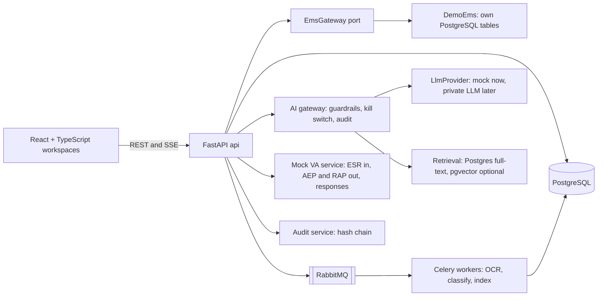
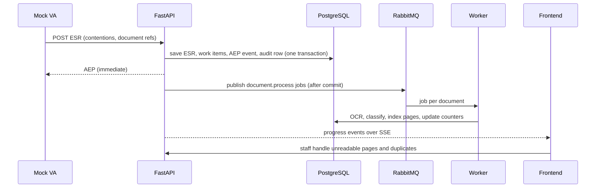

# MDE-NG Backend: design for the demo prototype

**Audience:** the backend developer. **Goal:** a working prototype for the scoping call, running on synthetic mock data, that replaces the browser-local state in the React app with a real API, database, async workers and guarded AI services.
**Out of scope:** real VA connections, real veteran data, a real LLM (a provider interface is included so one can be plugged in later).

This is the demo slice of the production design in "MDE-NG backend and AI system design". Where the demo simplifies something, section 12 says what production does instead.

For the current local implementation, see the [backend setup](README.md): the workspace, reference library, job queue and accounts use SQLite under `backend/data/`, not the PostgreSQL and RabbitMQ architecture proposed here.

---

## 1. Alignment with the frontend README

The backend design matches the frontend README on almost every point. Five items were adjusted or added.

| Frontend README says | Backend design | Status |
|---|---|---|
| React workspaces call EMS-controlled services; AI workers never touch VA systems | FastAPI REST plus server-sent events. Workers and AI have no route to VA or the internet | Aligned |
| FastAPI for authenticated APIs, authorization, business rules, workflow | One router per stage, a state machine with guards, role checks on the server | Aligned |
| PostgreSQL holds ESR, event, workflow, audit and AI metadata | Same (section 5) | Aligned |
| Durable queue or workflow engine (RabbitMQ, Temporal named) | RabbitMQ plus Celery in the demo. Temporal in production for long timers | Aligned, simplified |
| Isolated OCR workers | Separate worker container with no network egress. OCR is simulated from pre-extracted text | Aligned |
| Private LLM and retrieval | `LlmProvider` interface, mock in the demo. Retrieval is Postgres full-text search, pgvector optional | Aligned |
| Rules services for eligibility, DBQ completeness, signatures, package schemas | Deterministic validators. AI can rank or explain but never override a gate | Aligned |
| Audit records model version, sources, reviewer disposition | `ai_suggestion` and `audit_event` tables, hash-chained | Aligned |
| AI outage must not block the EMS | Kill switch plus fallbacks. Every endpoint works with AI off | Aligned |
| AEP must not wait for document processing | The AEP is created and returned in the same transaction that saves the ESR. Documents run afterward | Adjusted: made explicit |
| One ESR can hold several exams moving at different speeds | New `exam_work_item` entity with its own stage. ESR status is rolled up from its items | Adjusted: added |
| Attempts, distance limits, SMOT, IDES come from policy, not from a model | Versioned `policy_config` table read by the rules engine | New |
| Fully autonomous outreach is not assumed | The demo ranks examiners, drafts messages and logs attempts. No live calls or texts | Adjusted: narrower than my earlier scheduling agent |
| Keep originals at the approved source where possible | Store source references and extracted text. Original files exist only as synthetic seed files | Adjusted |
| The backend holds authoritative ESR and workflow state (the README calls it the "future EMS") | Our earlier design assumed the client's EMS owns that state | **Conflict, resolved below (D1)** |

**What I could not check:** I only had the README, not `frontend/src/stages/model.ts` or the page components. The field-level shapes (names, enums, ids) must be taken from `model.ts` when the API schemas are written. See section 14.

## 2. Key decisions

- **D1. An `EmsGateway` port.** All case and workflow state sits behind one interface. The demo implementation (`DemoEms`) uses our own PostgreSQL tables. A later `ClientEms` implementation would call the client's real EMS API. This lets the demo show a full workflow without making the product depend on replacing the client's EMS. Pitch it as "where our helpers appear in your workflow".
- **D2. Acknowledge first, process later.** Intake saves the ESR, creates the AEP, returns, and only then queues document jobs.
- **D3. Rules gate, AI suggests.** Eligibility, required fields, signatures, versions and schemas are plain code. AI output is stored as a suggestion with sources and needs a human disposition.
- **D4. Policy is data.** Outreach attempts, distance limits, special approvals and timelines live in `policy_config` with an effective date and a source reference. Nothing is hard-coded or left to a model.
- **D5. Mock-first AI behind real interfaces.** The mock providers return deterministic output built from seed text and cite real pages, so the demo behaves consistently.
- **D6. Tamper-evident audit.** Every action writes a hash-chained audit row, and an endpoint verifies the chain. This is cheap to build and strong for the security story.
- **D7. Demo simplifications are labeled.** The UI shows a "synthetic data" banner. No control is presented as a live VA integration.

## 3. Architecture



Network rule for the demo (docker compose): the `workers` and `ai` containers sit on an internal network with no internet access. Only `api` is exposed to the frontend.

### Intake sequence (the most important flow to get right)



## 4. Repository layout

```
backend/
  app/
    main.py                  # FastAPI app, CORS, routers, health
    api/                     # one router per stage: intake, triage, scheduling,
                             #   clinical, qa, delivery, ai, audit, demo
    core/                    # config, db session, security, audit, events, flags
    domain/                  # models, schemas, state machine, policy, permissions
    services/                # intake, triage, scheduling, clinical, qa, delivery
    ai/                      # gateway, guard, providers/, retrieval, validators
    integrations/            # ems_gateway.py, demo_ems.py, mock_va.py
    workers/                 # celery_app.py, tasks_documents.py
  seed/                      # cases.json, examiners.json, dbq_definitions.json,
                             #   policy.json, documents/ (synthetic text per page)
  alembic/                   # migrations
  tests/
  docker-compose.yml         # api, worker, rabbitmq, postgres, (optional) frontend
  pyproject.toml
```

Stack: Python 3.12, FastAPI, SQLAlchemy 2 with Alembic, Pydantic v2, Celery with RabbitMQ, PostgreSQL 16.

---

## 5. Data model

All tables have `id`, `created_at`, `updated_at`. State-changing rows also carry a `version` integer for optimistic locking.

| Table | Key fields | Notes |
|---|---|---|
| `esr` | `esr_id` (for example ESR-DEMO-10482), `received_at`, `aep_sent_at`, `status`, `policy_version`, `due_at` | Status rolls up from work items |
| `contention` | `esr_id`, `text`, `body_system` | One ESR has several |
| `exam_work_item` | `esr_id`, `contention_ids`, `exam_type`, `stage`, `status`, `assigned_to`, `version` | Moves through stages independently |
| `document` | `esr_id`, `source_ref`, `doc_class`, `page_count`, `status`, `content_hash`, `duplicate_of` | Reference to source, not a copy |
| `document_page` | `document_id`, `page_no`, `text`, `ocr_status` (ok or unreadable), `tsv` | `tsv` is the full-text index |
| `intake_exception` | `esr_id`, `kind` (unreadable_pages, duplicate, missing_record), `status`, `disposition`, `by` | Staff resolve or escalate |
| `triage_plan` | `work_item_id`, `dbq_codes`, `modality`, `diagnostics`, `rationale`, `status`, `approved_by` | Human-approved |
| `ai_suggestion` | `kind`, `target_type`, `target_id`, `content_json`, `sources` (doc, page, excerpt), `model_version`, `prompt_version`, `guard_result`, `status`, `disposition_by`, `disposition_at` | Status: proposed, accepted, changed, dismissed |
| `examiner` | `name`, `specialty`, `facility_id`, `sex`, `home_location` | |
| `credential` | `examiner_id`, `type` (license, va_training), `expires_on` | Eligibility reads this |
| `facility` | `name`, `location`, `accessibility` | |
| `availability_slot` | `examiner_id`, `starts_at`, `ends_at`, `status` | |
| `appointment` | `work_item_id`, `examiner_id`, `slot_id`, `status`, `confirmed_by` | |
| `outreach_attempt` | `work_item_id`, `attempt_no`, `channel`, `at`, `outcome`, `notes` | Policy sets the maximum |
| `dbq_definition` | `code`, `version`, `fields_json`, `effective_from` | Drives the form and validation |
| `dbq_report` | `work_item_id`, `dbq_code`, `definition_version`, `version_no`, `findings_json`, `status`, `signed_by`, `signed_at` | Status: draft, signed, returned, approved. Never edited after signing; corrections create a new `version_no` |
| `qa_finding` | `report_id`, `version_no`, `source` (rule or ai), `severity` (blocking or advisory), `section`, `text`, `evidence_refs`, `status`, `disposition` | Blocking findings stop release |
| `package` | `esr_id`, `items_json`, `schema_validation_json`, `status` | |
| `va_event` | `esr_id`, `kind` (ESR_IN, AEP_OUT, RAP_OUT, RESPONSE_IN, ERROR_IN), `direction`, `payload`, `correlation_id`, `at` | Real events only, never invented |
| `reconciliation` | `esr_id`, `status`, `evidence_json`, `closed_by` | |
| `policy_config` | `key`, `value_json`, `effective_from`, `source_ref` | Versioned |
| `audit_event` | `seq`, `at`, `actor`, `action`, `object_ref`, `detail_hash`, `prev_hash`, `hash`, `ai_ref` | Append-only |
| `app_user` | `name`, `role`, `active` | Demo users |
| `module_flag` | `name`, `enabled`, `changed_by`, `changed_at` | Kill switches |

### State machine: stage gates

A work item advances only when the guard passes. Guards run on the server, not in the UI.

| Move | Guard |
|---|---|
| Intake to Triage | Every document is processed or has a recorded exception disposition. ESR accepted and AEP sent |
| Triage to Scheduling | Approved plan with DBQs, modality and written rationale, approved by a case builder or clinical reviewer |
| Scheduling to Clinical | Confirmed appointment with an examiner who passes every eligibility rule |
| Clinical to QA | Every planned DBQ signed by the clinician role, with license and NPI present |
| QA to Delivery | No open blocking findings. Report version is the approved one |
| Delivery to Closed | Package validated, transmission and response events recorded, reconciliation evidence saved |

Separation of duties: the user who signed a DBQ cannot be the QA approver of that same report.

## 6. API contract

Conventions: JSON over HTTPS. ISO 8601 timestamps. Lists use `?limit=&cursor=`. Errors use RFC 7807 (`application/problem+json`). State-changing POSTs accept an `Idempotency-Key` header. Updates send the row `version` and get 409 on a conflict. OpenAPI is served at `/docs`, and the frontend generates its types from it.

### Cross-cutting

| Method and path | Purpose |
|---|---|
| `POST /api/auth/login` | Demo login, returns a JWT with role |
| `GET /api/cases?query=&stage=&status=` | Case list and search (the header search and the Intake filter) |
| `GET /api/cases/{esr_id}` | Selected-case summary: contentions, work items, clocks |
| `GET /api/cases/{esr_id}/timeline` | Combined audit and VA event timeline |
| `GET /api/events/stream` | Server-sent events: document progress, notifications, status changes |
| `GET /api/notifications` | Notification list |
| `GET /api/health` | Liveness and dependency status |

### Stage 1: Intake

| Method and path | Purpose |
|---|---|
| `POST /api/mock-va/esr` | Simulate VA sending an ESR. Returns the AEP immediately |
| `GET /api/esrs/{id}/documents` | Documents with classification and page counts |
| `GET /api/esrs/{id}/processing` | Counters: received, classified, unreadable, duplicates |
| `GET /api/documents/{id}/pages/{n}` | Page text and source reference (the expandable source references) |
| `POST /api/esrs/{id}/exceptions/{exc_id}/disposition` | Record staff decision on an exception |
| `GET /api/esrs/{id}/handoff/triage` | Preview of the Stage 2 handoff |
| `POST /api/esrs/{id}/intake/complete` | Pass the guard and move to Triage |

### Stage 2: Medical Triage

| Method and path | Purpose |
|---|---|
| `GET /api/esrs/{id}/evidence/search?q=` | Search cited excerpts |
| `GET /api/contentions/{id}/summary` | AI cited summary. Each statement carries document and page |
| `GET /api/contentions/{id}/dbq-suggestions` | Suggested DBQ mappings and evidence gaps |
| `PUT /api/work-items/{id}/plan` | Save DBQs, modality, diagnostics and rationale |
| `POST /api/work-items/{id}/plan/approve` | Approve and route to Scheduling |

### Stage 3: Scheduling

| Method and path | Purpose |
|---|---|
| `GET /api/work-items/{id}/examiners` | Eligible examiners ranked, plus the excluded ones with the failing rule |
| `GET /api/examiners/{id}/availability?from=&to=` | Calendar slots |
| `POST /api/work-items/{id}/outreach` | Record an outreach attempt. Enforces the policy maximum |
| `GET /api/work-items/{id}/booking-checks` | Checklist: preferences, approvals, notices |
| `POST /api/work-items/{id}/appointment/confirm` | Confirm. Rejected with 422 if any eligibility rule fails |

### Stage 4: Clinical Evaluation

| Method and path | Purpose |
|---|---|
| `GET /api/work-items/{id}/clinical` | Authorized evidence excerpts and the current DBQ definition |
| `GET /api/dbq-definitions/{code}` | Form definition and version |
| `PUT /api/reports/{id}/findings` | Save structured findings (draft only) |
| `POST /api/reports/{id}/validate` | Run deterministic completeness checks |
| `GET /api/reports/{id}/suggestions` | Copilot suggestions with citations |
| `POST /api/work-items/{id}/dbq-change` | Switch or add a DBQ (for example Wrist to Peripheral Nerves) |
| `POST /api/reports/{id}/sign` | Clinician-only. Locks that report version |

### Stage 5: Internal QA

| Method and path | Purpose |
|---|---|
| `GET /api/qa/queue` | Reports waiting for review |
| `GET /api/reports/{id}/versions` and `/compare?a=&b=` | Revision history and comparison |
| `GET /api/reports/{id}/qa-checks` | Deterministic checks and AI findings, with section and evidence links |
| `POST /api/qa/findings/{fid}/disposition` | Verify, dismiss with reason, or escalate |
| `POST /api/reports/{id}/return` | Create a versioned rework task |
| `POST /api/reports/{id}/approve` | QA-only. Rejected while a blocking finding is open |

### Stage 6: VA Delivery and Review

| Method and path | Purpose |
|---|---|
| `GET /api/esrs/{id}/package` | Required-items checklist and assembled package |
| `POST /api/esrs/{id}/package/validate` | Schema validation |
| `POST /api/esrs/{id}/package/transmit` | Send to the Mock VA service and record the event |
| `POST /api/mock-va/responses` | Simulate receipt, error or rework request from VA |
| `GET /api/esrs/{id}/va-events` | Transmission and response events |
| `POST /api/esrs/{id}/reconcile` | Close only when required evidence exists |
| `GET /api/delivery/exceptions` | Failed or unacknowledged packages |

### AI governance and audit

| Method and path | Purpose |
|---|---|
| `POST /api/ai/suggestions/{id}/disposition` | Accept, change or dismiss, with reason |
| `GET /api/ai/modules` and `POST /api/ai/modules/{name}/toggle` | Kill switches |
| `GET /api/audit?esr_id=&actor=` | Audit log |
| `GET /api/audit/verify` | Walks the hash chain and reports the first break, if any |
| `GET /api/metrics/kpis` | Reviewer accept rate, guardrail hits, cases by stage, clocks |

### Demo controls

| Method and path | Purpose |
|---|---|
| `POST /api/demo/reset` | Reload seed data |
| `POST /api/demo/scenarios/{name}` | Jump to a prepared scenario (section 10) |
| `POST /api/demo/tamper-audit` | Demo only. Alters one audit row so `verify` visibly fails |

---

## 7. Async processing and clocks

**Document jobs** (Celery tasks on RabbitMQ, retried with backoff, safe to run twice):

1. `fetch`: read the document's pages from the seed store using the source reference.
2. `ocr`: the demo reads pre-extracted text. A page marked unreadable in the seed fails here, so the "5 unreadable pages" case is real behavior, not a label.
3. `classify`: rules and keyword scoring assign a class (service treatment records, hospital records, lab report, unreadable).
4. `dedupe`: content hash plus text similarity flags possible duplicates. Never auto-deletes.
5. `index`: build the full-text index (and optional embeddings) per page.
6. Update the counters, write an audit row, push a progress event to SSE.

A `DEMO_SPEED` setting (for example 1 to 10) paces the steps so the audience can watch 280 pages complete in about 20 to 30 seconds.

**Reliability rules:** the outbox pattern (job rows saved in the same transaction, a relay publishes them), idempotent tasks keyed by `document_id + step`, a dead-letter queue visible at `/api/health`, and no job logs page text.

**Clocks** are computed from `policy_config`, not stored: AEP time, days used and days left toward the timeliness target, and business days. Celery beat checks every minute and raises notifications for at-risk cases.

## 8. AI services

One controlled gateway with specialized capabilities, as the README describes. Every AI call goes through the same wrapper.

```python
class LlmProvider(Protocol):
    name: str
    version: str
    def generate(self, task: str, inputs: dict, sources: list[Source]) -> AiDraft: ...

def guarded_call(module: str, task: str, inputs: dict, user) -> AiResult:
    if not flags.enabled(module):                 # kill switch
        return AiResult.unavailable(module)       # UI continues without AI
    check_input(inputs)                           # size, scope, authorization to sources
    draft = provider.generate(task, inputs, authorized_sources(user, inputs))
    verified = verify_output(draft)               # every claim must cite a real page,
                                                  # prohibited content removed, schema ok
    suggestion = save_suggestion(verified, provider.version, PROMPT_VERSION)
    audit("ai.suggestion", suggestion.id, user)
    return AiResult.proposed(suggestion)          # needs a human disposition
```

| Capability | Input | Output | Demo implementation | Guardrail |
|---|---|---|---|---|
| Document processor | Pages | Class, duplicates, unreadable flags | Rules plus hashes | Original never altered. Unreadable pages go to staff |
| Evidence search | Query, ESR | Ranked excerpts | Postgres full-text search | Only the user's authorized ESR |
| Cited summarizer | Contention, excerpts | Dated summary with citations | Template over top excerpts | Citation verifier drops any statement without a real page |
| DBQ mapper | Contention, evidence | Candidate DBQs, evidence gaps | Keyword rules from seed | Suggestion only. Reviewer picks |
| Examiner ranker | Plan, eligible examiners | Ranked list with explanation | Weighted score, explanation from score parts | Runs only on examiners that passed the deterministic gate |
| Clinical copilot | Draft findings, evidence | Missing-detail and inconsistency hints | Deterministic checks plus seeded hint rules | Never edits findings. Never diagnoses or judges risk |
| QA reviewer | Signed report, evidence | Cited findings | Deterministic checks plus seeded findings | Blocking findings need a human disposition |
| Reconciliation assistant | Failed response | Plain summary and a suggested review step | Template | Cannot create receipts or change VA responses |
| Lab alert | Incoming result | Alert to a qualified person | Rule on critical values from policy | Separate path. Rules decide, not a model |

**Eligibility is code, not AI.** The gate checks specialty and scope, license and VA training dates, facility accessibility, distance limit, and claimant preference. It returns, for each excluded examiner, the failing rule. The ranker never sees them.

**Prohibited output filter** removes things like an estimated disability percentage and any statement that reads as a diagnosis or a medical opinion written by the AI.

**Quality hooks:** a tiny evaluation set of seeded cases with expected citations, run in CI. It checks that every summary sentence cites a page that exists and contains the cited words.

## 9. Security baseline

Security is the main selling point, so the demo should show it working, not only describe it.

| Area | In the demo | In production |
|---|---|---|
| Sign-in | JWT login with demo users and roles: intake, case builder, scheduler, clinician, QA, delivery, admin | PIV smart card and FIDO2 MFA through the client's identity provider |
| Authorization | Server checks role and ownership on every state-changing endpoint. Clinician-only sign, QA-only approve, separation of duties | Same, plus attribute rules per contract and facility |
| Audit | Append-only, hash-chained rows. `GET /api/audit/verify` and the tamper demo | Immutable storage with object lock, SIEM export |
| Data | Synthetic data only. Sensitive fields encrypted at the application level with a key from the environment | KMS or HSM keys per tenant, encryption at rest, re-key process |
| Network | Docker `internal` network for workers and AI. Only `api` published. CORS limited to the frontend origin | Private subnets, mTLS, no egress from AI and data tiers |
| AI | Mock providers. No outbound calls possible. A "poisoned" seed document with an embedded instruction that the system must ignore | Self-hosted models, signed model files, prompt-injection tests |
| Logging | Structured logs with a redaction filter. No page text or names in logs | PHI-free logs to the SIEM |
| Supply chain | `pip-audit`, an SBOM (`syft`) and a container scan (`grype` or `trivy`) as make targets and CI steps | Signed images and admission policy |
| Secrets | Environment variables, `.env.example` only in the repo | Secrets manager |
| Input | Pydantic validation, size limits, no file uploads in the demo | Same, plus malware scanning if uploads exist |
| Resilience | Per-IP rate limit, request timeouts, idempotency keys | Plus WAF |

Permission matrix (server-enforced):

| Action | Intake | Case builder | Scheduler | Clinician | QA | Delivery | Admin |
|---|---|---|---|---|---|---|---|
| Disposition intake exceptions | yes | | | | | | yes |
| Approve triage plan | | yes | | | | | |
| Confirm appointment | | | yes | | | | |
| Save and sign DBQ | | | | yes | | | |
| Approve or return report | | | | | yes | | |
| Transmit package, reconcile | | | | | | yes | |
| Toggle AI module, run audit verify | | | | | | | yes |

## 10. Mock data and demo scenarios

Use **ESR-DEMO-10482**, the case in the frontend README: knee pain, tinnitus and a depression-related contention, 280 pages received, 275 classified and indexed, 5 unreadable.

**Note:** the earlier Examination Workspace HTML prototype used a different case (ESR-26-04827, Terrance Whitlock). Standardize on the README case for the demo build.

Seed set:

- **Cases:** ESR-DEMO-10482 plus about six more at different stages, so the case list, filters and stage ribbon look real.
- **Documents:** synthetic page text for service treatment records, hospital records, lab reports and 5 unreadable pages. Include a knee treatment record with a clear citable statement.
- **Examiners (about 8):** one with an expired license, one with expired VA training, one whose facility lacks access features, one that fails the distance limit, one with a sex-preference mismatch, and a few eligible ones with different fit.
- **DBQ definitions:** Knee and Lower Leg, Tinnitus, Mental Disorders, Wrist, Peripheral Nerves, each with versioned fields.
- **Policy:** outreach attempt maximum, distance limits, timeliness targets, each with a source reference.

Scenarios loaded with `POST /api/demo/scenarios/{name}`:

| Name | What it shows |
|---|---|
| `happy_path` | The full journey from ESR to reconciliation |
| `missing_records` | Intake exception and staff disposition |
| `ineligible_examiner` | Booking blocked by the gate, also via a direct API call |
| `dbq_switch` | Wrist DBQ changed to Peripheral Nerves during the exam |
| `qa_blocking_finding` | Approval locked until the correction is verified, with a new report version |
| `va_schema_error` | Failed response, reconciliation summary, approved retry |
| `ai_off` | A kill switch is off and every stage still works |
| `poisoned_document` | A document tries to instruct the AI and is ignored and logged |
| `audit_tamper` | One row altered, `verify` fails and names the row |

## 11. Demo performance targets

- AEP returned in under 1 second, with document processing still running.
- Any read endpoint under 300 ms on the seed data.
- The 280-page pipeline finishes in 20 to 30 seconds at the default `DEMO_SPEED`.
- State survives a browser refresh and a backend restart.
- Reset to a clean seed in under 10 seconds.

## 12. Demo versus production

| Component | Demo | Production |
|---|---|---|
| Case state | `DemoEms` on our PostgreSQL | `ClientEms` adapter to the client's EMS API, or our own EMS if that is the agreed scope |
| VA connections | Mock VA service | VA TIC gateway, DAS, VBMS, Caseflow through the EMS |
| Queue and workflows | RabbitMQ, Celery, beat timers | RabbitMQ and Temporal for long-running timers |
| OCR | Pre-extracted text, simulated failures | Self-hosted GPU OCR |
| LLM | Mock provider | Self-hosted open-weights models in the private network |
| Retrieval | Postgres full-text, pgvector optional | pgvector scoped per case, vectors only for cases in flight |
| Identity | Demo JWT | PIV and FIDO2 MFA |
| Keys | Environment variable | KMS or HSM, per tenant |
| Audit | Hash chain in PostgreSQL | Immutable storage plus SIEM |
| Hosting | Docker compose on a laptop or one VM | Single-tenant government cloud account, Kubernetes, multi-zone |

---

## 13. Build plan

Build vertically: finish one stage end to end (database, API, worker, frontend wiring) before the next. Sizes are relative: S is about a day, M a few days, L about a week.

| Step | Scope | Size | Done when |
|---|---|---|---|
| 0. Scaffold | Repo, docker compose (api, worker, rabbitmq, postgres), Alembic, health endpoint, CI with lint and tests | S | `docker compose up` gives a healthy `/api/health` |
| 1. Foundations | Models, auth with roles, permission checks, audit hash chain, `module_flag`, seed loader, `demo/reset` | M | Login works, audit verify passes, reset reloads seed |
| 2. Intake | Mock VA ESR, immediate AEP, document pipeline, SSE progress, exceptions, handoff | L | 280-page case processes visibly, 5 unreadable pages land in exceptions |
| 3. Triage | Evidence search, cited summarizer with citation verifier, DBQ mapper, plan save and approve | L | Every summary sentence links to a real page |
| 4. Scheduling | Policy config, eligibility gate, ranker with explanations, calendar, outreach log, confirm | M | Ineligible examiner is refused even by a direct API call |
| 5. Clinical | DBQ definitions, findings save, validation, copilot hints, DBQ switch, sign | M | Only the clinician role can sign, signed version is locked |
| 6. QA | Versioned reports, deterministic checks, seeded AI findings, dispositions, return, approve | M | Approval is blocked while a blocking finding is open |
| 7. Delivery | Package checklist, schema validation, mock transmit, response simulator, reconcile | M | Case closes only with reconciliation evidence |
| 8. Governance | Kill switches, suggestion dispositions, KPI endpoint, audit verify and tamper demo, scenarios | M | All nine scenarios in section 10 run from one command |
| 9. Hardening and polish | Rate limits, log redaction, SBOM and scans, load test on seed, demo script rehearsal | M | Section 15 checklist is fully ticked |

Steps 2 to 7 map one-to-one to the frontend stage pages, so the frontend developer can switch each page from local state to the API as its backend step lands.

## 14. Needed from the frontend developer, and open questions

**Needed to finalize the API schemas:**

1. `frontend/src/stages/model.ts` (the sample cases and stage metadata). Backend schemas should match its field names and enums exactly.
2. A list of every button or control per stage page and the data it needs, so each maps to an endpoint in section 6.
3. Whether the app has a login screen or assumes one user. The backend supports roles either way.
4. Preference for live updates: server-sent events (planned) or polling.
5. The error display format the UI expects, so the backend can return matching problem details.

**Open questions:**

- Real LLM for the call, or mock only? The design works either way. A real model would run on a laptop or a cloud sandbox with synthetic data only.
- Where does the demo run on the day: a laptop, or a hosted environment the client can also open?
- Should the demo show the "client's EMS" adapter idea (a second mock EMS behind `EmsGateway`)? It is small if the interface exists from step 0.
- FIPS 140-2 or 140-3 in the production claims? The two source documents differ. The demo does not depend on it.
- How much of the earlier "AI layer" prototype (six helper modules) should be reachable in the same app? The stage-based AI capabilities in section 8 cover the same ground.

## 15. Demo acceptance checklist

- [ ] Creating an ESR through the mock VA returns an AEP in under 1 second while documents are still processing.
- [ ] Progress for the 280-page case updates live and ends at 275 classified and 5 unreadable.
- [ ] Refreshing the browser or restarting the backend keeps all state.
- [ ] Every summary sentence in Triage opens a real source page that contains the cited text.
- [ ] An ineligible examiner cannot be booked, in the UI or by calling the API directly, and the failing rule is shown.
- [ ] Only a clinician can sign. Only QA can approve. The signer cannot approve their own report.
- [ ] Approval is blocked while a blocking QA finding is open, and a corrected report is a new version.
- [ ] Delivery cannot close without recorded transmission, response and reconciliation evidence.
- [ ] Turning an AI module off leaves every stage working.
- [ ] The poisoned document is ignored and the attempt appears in the audit log.
- [ ] `GET /api/audit/verify` passes, and fails with the row number after the tamper demo.
- [ ] No workers or AI containers can reach the internet (checked by a test).
- [ ] Logs contain no page text or names.
- [ ] The UI shows a clear "synthetic data" banner.
